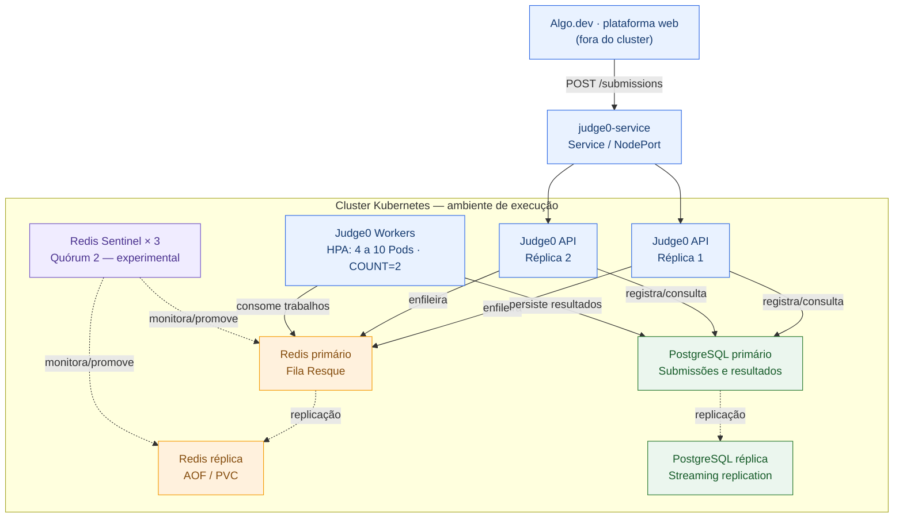

<div align="center">

# ⚙️ Judge0 em Kubernetes

### Infraestrutura para execução automatizada de códigos — Projeto Algo.dev

**Escalabilidade • Distribuição de carga • Disponibilidade • Avaliação experimental**

[](https://ifpr.edu.br/)


*Trabalho de Conclusão de Curso — Tecnologia em Análise e Desenvolvimento de Sistemas*<br>
*Instituto Federal do Paraná (IFPR) — Campus Cascavel · 2026*

</div>

---

## Sobre o projeto

Este repositório apresenta a **implantação e a avaliação experimental de uma infraestrutura Kubernetes para o Judge0**, sistema responsável pela execução automatizada de códigos de programação. O estudo integra o projeto **Algo.dev** (anteriormente denominado Dev³), voltado ao apoio de atividades de programação.

A plataforma web Algo.dev **permanece fora do cluster**. O objeto de estudo é o ambiente que recebe as submissões encaminhadas ao Judge0, organiza os trabalhos em uma fila, executa os códigos de maneira isolada e mantém seus resultados para consulta.

A implantação evoluiu de um laboratório com **Docker Desktop e Minikube** para um **cluster físico de três máquinas**. Foram realizados experimentos com diferentes quantidades de réplicas, configurações de paralelismo e cargas de trabalho, além de testes de indisponibilidade de nós, persistência e replicação de serviços de dados.

> [!IMPORTANT]
> **Este é um ambiente acadêmico e experimental.** As funcionalidades de escalonamento, persistência e replicação descritas aqui **não equivalem a uma garantia de alta disponibilidade de ponta a ponta**. O Redis Sentinel conseguiu promover uma réplica em testes, mas a reconexão do Judge0 ao novo primário permaneceu incompleta; a réplica PostgreSQL também não dispõe de promoção automática no cenário documentado.

## Navegação

- [Objetivos](#objetivos)
- [Arquitetura](#arquitetura)
- [Infraestrutura física](#infraestrutura-física)
- [Tecnologias e componentes](#tecnologias-e-componentes)
- [Configuração de referência](#configuração-de-referência)
- [Implantação e validação](#implantação-e-validação)
- [Ensaios experimentais](#ensaios-experimentais)
- [Persistência e disponibilidade](#persistência-e-disponibilidade)
- [Organização do repositório](#organização-do-repositório)
- [Limitações e trabalhos futuros](#limitações-e-trabalhos-futuros)
- [Referências e créditos](#referências-e-créditos)

---

## Objetivos

O trabalho busca analisar, na prática, **como decisões de infraestrutura influenciam o comportamento do Judge0** diante de diferentes cargas e situações de falha. Os objetivos específicos contemplam:

1. Implantar e integrar API, Workers, Redis e PostgreSQL em Kubernetes.
2. Separar a **entrada de requisições** do **processamento assíncrono de códigos**.
3. Avaliar escalonamento horizontal dos Workers com **Horizontal Pod Autoscaler (HPA)**.
4. Comparar configurações de **paralelismo interno (`COUNT`)** e recursos de CPU/memória.
5. Medir **vazão, latência, p95, taxa de conclusão, falhas e comportamento dos nós**.
6. Avaliar persistência, replicação e continuidade de processamento diante da indisponibilidade de componentes.

A hipótese central não é que “mais réplicas sempre executam mais rápido”, e sim que **a arquitetura e seu dimensionamento precisam ser avaliados por evidências**.

---

## Arquitetura

### Visão lógica



**Como uma submissão é processada:** a aplicação encaminha código para a API Judge0; a API registra a submissão e agenda um trabalho no Redis/Resque; um Worker disponível **busca** esse trabalho, executa o programa em uma sandbox e persiste o resultado no PostgreSQL. O cliente consulta a API por meio do token recebido até observar um estado final.

**Três distinções importantes:**

- **`Service` não é fila:** o Service do Kubernetes encaminha tráfego HTTP para as réplicas da API; o Redis/Resque intermedeia trabalhos assíncronos consumidos pelos Workers.
- **`COUNT` não é número de Pods:** `COUNT=2` representa paralelismo **dentro de cada Pod Worker**. Quatro Pods com `COUNT=2` representam até oito consumidores nominais, condicionados aos recursos físicos.
- **Replicar não é fazer failover automaticamente:** réplicas de banco/fila e Pods prontos não comprovam, por si sós, que o fluxo completo continuará atendendo após uma falha.
- **HPA não é necessário para o Redis deste desenho:** o HPA em `judge0/hpa.yaml` escala os Workers (`wk-judge0`). Redis tem um Deployment para o primário e outro para a réplica, ambos com uma instância; aumentar cópias do mesmo primário não é uma forma segura de escalar Redis.

---

## Infraestrutura física

O cluster principal foi montado com **um plano de controle ARM e dois nós de execução AMD64**.

| Equipamento | Função | Características registradas |
|---|---|---|
| **Raspberry Pi 3 B+** | Control-plane Kubernetes | ARM, aproximadamente 1 GB RAM, Ubuntu 22.04.5 LTS. |
| **Dell OptiPlex 3080 — nó 1** | Execução de aplicações e serviços de dados | Intel Core i3 de 9ª geração, 8 GB RAM, AMD64, Ubuntu 22.04.5 LTS. |
| **Dell OptiPlex 3080 — nó 2** | Execução de aplicações e serviços de dados | Intel Core i3 de 9ª geração, 8 GB RAM, AMD64, Ubuntu 22.04.5 LTS. |

A Raspberry é responsável pelos componentes de gerenciamento do Kubernetes. Os dois Dell hospedam as cargas do Judge0. Para controlar a compatibilidade de arquitetura foi utilizada a seleção de nós AMD64, documentada nos manifests da fase física:

```yaml
nodeSelector:
  kubernetes.io/arch: amd64
```

A distribuição registrada na evolução da arquitetura posicionou **PostgreSQL primário + Redis réplica** no primeiro Dell, e **PostgreSQL réplica + Redis primário** no segundo, com réplicas da API e dos Workers distribuídas entre ambos. O posicionamento efetivo deve ser confirmado com `kubectl get pods -o wide`.

> **Versões de software:** os registros do laboratório de setembro citam Kubernetes v1.26.15, Flannel e containerd, mas o inventário deve ser obtido novamente antes de informar **versões atualmente executadas**. A mesma pesquisa utilizou mais de um ambiente ao longo do tempo; valores de clusters diferentes não devem ser misturados.

---

## Tecnologias e componentes

| Camada | Tecnologia | Papel |
|---|---|---|
| Orquestração | **Kubernetes** | Agendamento, reconciliação de Pods, Services e escalonamento. |
| Execução de código | **Judge0 CE** | API de submissões e execução isolada dos códigos. |
| Fila | **Redis + Resque** | Organização dos trabalhos pendentes e consumo assíncrono. |
| Persistência | **PostgreSQL** | Submissões, estados e resultados. |
| Escalabilidade | **HPA + Metrics Server** | Ajuste da quantidade de Pods Worker pela utilização de CPU. |
| Métricas | **Prometheus, kube-state-metrics e cAdvisor** | Observação do consumo e do estado dos recursos. |
| Visualização | **Grafana** | Painéis para acompanhamento dos experimentos. |
| Replicação de dados | **PostgreSQL streaming replication / Redis replication** | Manutenção de cópias em nós distintos. |
| Experimentos de failover | **Redis Sentinel** | Detecção e promoção de réplica, ainda sem recuperação completa da aplicação. |
| Automação de testes | **Shell + Python** | Alteração controlada de parâmetros, geração de carga, coleta de resultados. |

## Configuração de referência

A configuração abaixo foi consolidada ao longo dos testes. Ela serve como **baseline experimental** e deve ser comparada com os manifests atuais antes de qualquer nova rodada.

| Parâmetro | Judge0 API | Judge0 Workers |
|---|---:|---:|
| Réplicas | **2 fixas** | **HPA: 4 a 10** |
| CPU `request` | `250m` | `500m` |
| CPU `limit` | `1000m` | `1500m` |
| Memória `request` | `256Mi` | `512Mi` |
| Memória `limit` | `1Gi` | `2Gi` |
| Paralelismo | `RAILS_SERVER_PROCESSES=2` / `RAILS_MAX_THREADS=4` | `COUNT=2` |
| Escalonamento automático | Não confirmado para API | CPU média, **100% do request** |

`500m` equivale a 0,5 CPU; `1500m`, a 1,5 CPU. **`request`** participa do agendamento e da referência percentual do HPA. **`limit`** estabelece um teto de consumo; não aumenta a capacidade física dos equipamentos.

**Por que `COUNT=2`?** Os testes mostraram melhor desempenho dessa configuração em condições avaliadas. Já `COUNT=4` apresentou instabilidade por pressão de memória em uma configuração mais restrita. Elevar o CPU request dos Workers para `1500m` também impediu o agendamento de uma réplica adicional (`Insufficient cpu`), motivando o retorno a `500m`.

---

## Implantação e validação

### Pré-requisitos

É necessário ter acesso autorizado a um cluster Kubernetes configurado, `kubectl` apontando para o **contexto correto**, suporte de rede entre os nós, runtime/container network funcional e os manifests/Secrets compatíveis com a versão do Judge0. O ambiente físico usa componentes que devem ser validados conforme as versões presentes no repositório, especialmente o mecanismo `isolate` e os controladores Linux de cgroups.

### 1. Identificar o ambiente antes de alterar recursos

```bash
kubectl config current-context
kubectl get nodes -o wide
kubectl get nodes -L kubernetes.io/arch
kubectl get pods -A -o wide
kubectl get deployments -A
kubectl get hpa -A
kubectl get pv,pvc -A
```

Esses comandos **não modificam o cluster**. Eles permitem conferir o contexto, a arquitetura dos nós, os Pods, o estado das réplicas, o HPA e os volumes existentes.

### 2. Conferir os arquivos do repositório

```bash
find judge0 -maxdepth 4 -type f | sort
find monitor -maxdepth 3 -type f | sort
git status --short
```

Há **organizações de diretório distintas no histórico**: a fase Minikube usava manifests mais centralizados; a fase de replicação separou serviços primários, réplicas e volumes. **Não execute um `kubectl apply` recursivo sem revisar os manifests que serão aplicados.**

### 3. Provisionar configurações com segurança

Os containers Judge0 utilizam um arquivo `judge0.conf` disponibilizado historicamente pelo Secret `vol-config`, e há também um Secret `judge0-env` para variáveis consumidas por componentes e scripts. O arquivo real deve ficar **fora do controle de versão**. Versione apenas os modelos `judge0.conf.example`/`.env.example`, sem credenciais.

Antes de qualquer implantação, confira os arquivos `.env.example`, os caminhos de configuração, o mecanismo de montagem (`subPath`) e a necessidade de rollout após mudanças.

#### Preparar e aplicar esta configuração

Não há um script instalador nem Kustomize neste fluxo. Prepare os arquivos locais a partir dos exemplos, edite as credenciais e mantenha tudo fora do Git:

```bash
cp judge0/config/.env.example judge0/config/.env
cp judge0/db/replica/.env.example judge0/db/replica/.env
cp monitor/.env.example monitor/.env
mkdir -p .local
cp judge0/config/judge0.conf.example .local/judge0.conf
```

Preencha os `.env` e o `.local/judge0.conf` com as credenciais apropriadas. Os valores de Redis e PostgreSQL em `judge0.conf` devem corresponder aos de `judge0/config/.env`. Confira o contexto ativo antes de criar Secrets ou aplicar manifests:

```bash
kubectl config current-context
```

Crie/atualize os Secrets localmente a partir desses arquivos e aplique os manifests:

```bash
kubectl create secret generic judge0-env --from-env-file=judge0/config/.env --dry-run=client -o yaml | kubectl apply -f -
kubectl create secret generic postgres-replication --from-env-file=judge0/db/replica/.env --dry-run=client -o yaml | kubectl apply -f -
kubectl create secret generic vol-config --from-file=judge0.conf=.local/judge0.conf --dry-run=client -o yaml | kubectl apply -f -
kubectl create namespace monitor --dry-run=client -o yaml | kubectl apply -f -
kubectl create secret generic grafana-auth -n monitor --from-env-file=monitor/.env --dry-run=client -o yaml | kubectl apply -f -
kubectl apply --recursive -f judge0/
kubectl apply -f monitor/monitor.yaml
```

Os três Secrets Judge0/PostgreSQL são criados no namespace atual do contexto `kubectl`; os manifests de aplicação sem `namespace` usam esse mesmo namespace. O Secret Grafana fica no namespace `monitor`. A pasta `replicacao/baseline-replicacao-cluster/` contém uma fotografia antiga e não é aplicada por esses comandos.

Antes de aplicar, confirme que `POSTGRES_REPLICATION_CIDR` corresponde ao Pod CIDR do cluster. Os PVs atuais usam paths `local` e hostnames fixos (`srv-kube-worker-1`/`srv-kube-worker-2`); esses diretórios precisam existir e ter permissões corretas nos nós. O instalador não cria nem copia dados de volumes.

O ConfigMap de inicialização do PostgreSQL cria o usuário de replicação e a regra do `pg_hba.conf` **somente quando o volume de dados é inicializado vazio**. Em volumes já inicializados, ele não altera usuários nem regras existentes. Depois de trocar um Secret usado por arquivo montado com `subPath`, faça um rollout controlado do Deployment consumidor.

As réplicas Redis e PostgreSQL podem receber dados, mas isso não completa failover ponta a ponta: Judge0 continua configurado para um endereço Redis estático, os Services não acompanham automaticamente a promoção do Sentinel e o PostgreSQL não possui promoção automática.

#### Grafana e dashboard

O Grafana já recebe o datasource Prometheus e o dashboard do Judge0 provisionados pelos ConfigMaps do monitoramento. Depois que os recursos forem aplicados e o Pod do Grafana estiver pronto, **não é preciso importar o dashboard manualmente**: ele aparece na pasta `TCC - Judge0`. Para abrir localmente:

```bash
kubectl port-forward -n monitor svc/grafana 3000:3000
```

Acesse `http://127.0.0.1:3000`. O usuário é `admin`; a senha é a definida em `monitor/.env` (`GF_SECURITY_ADMIN_PASSWORD`). Os painéis podem levar alguns instantes para exibir dados e dependem de Prometheus estar coletando métricas dos componentes.

### 4. Verificar comunicação e estado funcional

```bash
kubectl get svc
kubectl get pods -l app=srv-judge0 -o wide
kubectl get pods -l app=wk-judge0 -o wide
kubectl describe hpa wk-judge0-hpa
kubectl top nodes
```

O Service externo da API foi exposto historicamente na porta de aplicação **2358** e **NodePort 30000**. Após conferir a porta efetiva com `kubectl get svc`, é possível realizar um teste simples com `/languages` e um POST de submissão usando o endpoint configurado. O **token** retornado não substitui a verificação posterior do estado final `Accepted`.

> [!CAUTION]
> A implantação de volumes, recriação de Pods, alteração de Secrets ou promoção de réplicas pode afetar dados persistentes. Execute comandos que alterem o cluster **somente com plano de manutenção e reversão**, respeitando os procedimentos do laboratório.

---

## Ensaios experimentais

Os experimentos utilizaram carga sintética controlada para observar o comportamento da API, da fila, dos Workers e do HPA. Os resultados a seguir **pertencem ao hardware e às configurações especificados**, sem pretensão de estabelecer limites universais do Kubernetes ou Judge0.

### Paralelismo interno dos Workers

Teste inicial: **200 submissões por configuração**.

| `COUNT` | Tempo total | Vazão | Resultado |
|---:|---:|---:|---|
| 1 | 70,470 s | 2,84 exec./s | Estável |
| **2** | **43,265 s** | **4,62 exec./s** | **Melhor resultado observado** |
| 3 | 48,114 s | 4,16 exec./s | Estável |
| 4 | — | — | Instável, sem valor comparável |

### Ambiente frio × ambiente aquecido

No cenário de **800 execuções de perfil misto, com concorrência 20**, o ambiente **frio** iniciava com quatro réplicas mínimas de Workers. O **aquecido** reutilizava as réplicas ainda disponíveis após a rodada anterior. Essa diferença não isola o efeito do HPA de todos os outros efeitos do estado aquecido.

| `COUNT` | Condição | Tempo total | Vazão | `Accepted` |
|---:|---|---:|---:|---:|
| 1 | Frio | 73,225 s | 10,93 exec./s | 800/800 |
| 1 | Aquecido | 57,717 s | 13,86 exec./s | 800/800 |
| 2 | Frio | 61,940 s | 12,92 exec./s | 800/800 |
| **2** | **Aquecido** | **55,456 s** | **14,43 exec./s** | **800/800** |

### Teste prolongado com HPA

Foram realizadas **24 rodadas** ao longo de aproximadamente **duas horas**, com quatro repetições para cada combinação de carga e concorrência. O HPA alcançou dez réplicas e posteriormente reduziu a quantidade conforme a utilização de CPU diminuiu.

| Execuções por rodada | Concorrência | `Accepted` nas quatro rodadas | Falhas de POST | Vazão média | p95 médio* |
|---:|---:|---:|---:|---:|---:|
| 600 | 10 | 2400/2400 | 0 | 7,97 exec./s | 1,64 s |
| 800 | 20 | 3200/3200 | 0 | 11,52 exec./s | 2,55 s |
| 1000 | 30 | 4000/4000 | 0 | 13,23 exec./s | 3,33 s |
| **1200** | **40** | **4800/4800** | **0** | **13,29 exec./s** | **4,23 s** |
| 1500 | 50 | 5997/6000 | 3 | 13,23 exec./s | 5,15 s |
| 2000 | 75 | 7147/8000 | **853** | 13,79 exec./s | 5,67 s |

<sub>*O p95 médio é a média dos quatro valores de p95 calculados separadamente por rodada; não é o percentil conjunto de todas as execuções.</sub>

O maior nível concluído sem falhas de envio nesse protocolo foi **1200 execuções por rodada com concorrência 40**. Na maior carga, foram registradas **853 falhas de POST**, enquanto a vazão já apresentava uma região de crescimento limitado e a latência continuava aumentando.

### Testes de falha e isolamento

Nos ensaios anteriores à replicação dos serviços de dados, reiniciar um nó de execução enquanto Redis e PostgreSQL permaneciam no outro permitiu continuar o processamento, mas com perdas/timeout observados: **2381/2400 submissões** concluíram como `Accepted` nas três rodadas. Ao reiniciar o nó que hospedava **Redis e PostgreSQL**, o experimento registrou somente **423/800 `Accepted`**, evidenciando a dependência desses serviços.

O mecanismo `isolate` também foi avaliado com programas controlados, incluindo loop infinito, bloqueios de acesso a rede/arquivos e operações privilegiadas. Os resultados foram positivos **para os vetores testados**, mas **não constituem certificação de segurança do sandbox**.

---

## Persistência e disponibilidade

A arquitetura evoluiu para incorporar mecanismos de durabilidade e redundância:

| Recurso | Evolução implementada | Limitação observada |
|---|---|---|
| PostgreSQL | Primário e réplica em nós distintos, volumes PV/PVC locais e streaming replication | **Sem promoção automática** da réplica para escrita. |
| Redis | Primário e réplica com AOF e volumes independentes | Replicação é assíncrona; não garante recuperar todos os trabalhos em qualquer falha. |
| Redis Sentinel | Três instâncias, quórum 2 e promoção de réplica observada | Judge0 **não retomou corretamente** o acesso ao novo primário em teste; pressão de memória afetou Sentinel na Raspberry. |
| API e Workers | Duas APIs e múltiplos Workers, com HPA de CPU | Não substituem alta disponibilidade do banco, fila ou plano de controle. |

A principal conclusão desta etapa é que **a recuperação de um Pod ou a promoção de uma réplica não bastam para demonstrar disponibilidade do sistema completo**. É necessário validar o percurso inteiro de submissão, enfileiramento, processamento e consulta, incluindo o comportamento dos clientes durante falhas.

---

## Organização do repositório

A árvore abaixo representa os principais arquivos deste checkout. A configuração real de credenciais (`.env`) e o `judge0.conf` renderizado ficam fora do Git.

```text
judge0-kubernetes/
├── judge0/
│   ├── config/                 # configuração de exemplo e modelo de credenciais
│   ├── deployments.yaml        # API e Workers
│   ├── services.yaml           # exposição da API Judge0
│   ├── hpa.yaml                # autoscaling dos Workers
│   ├── db/
│   │   ├── primary/            # PostgreSQL primário, PVC/PV e bootstrap
│   │   └── replica/            # PostgreSQL standby, PVC/PV e Secret de exemplo
│   └── redis/
│       ├── primary/            # Redis primário, Services e AOF/PVC
│       ├── replica/            # Redis réplica e AOF/PVC
│       └── sentinel/           # bootstrap e três Deployments Sentinel
├── monitor/                    # Prometheus, Grafana, dashboard e Secret de exemplo
├── automacao/                  # ajuste de COUNT e parâmetros Rails
├── replicacao/                 # baseline histórico, fora dos comandos de implantação
└── README.md                   # arquitetura, experimentos e instruções
```

**Regra de versionamento:** não publicar `judge0.conf` com credenciais, `.env`, kubeconfigs, chaves privadas ou backups de banco. Devem existir arquivos `.example` sanitizados e `.gitignore` coerente.

---

## Limitações e trabalhos futuros

O estudo identifica possibilidades de evolução, mas elas **não devem ser apresentadas como já implementadas**:

- Concluir o **failover de ponta a ponta do Redis** e a reconexão do Judge0 ao primário promovido.
- Avaliar **promoção automática do PostgreSQL**, mecanismos de backup/restauração e objetivos de recuperação.
- Validar durabilidade das métricas e rastreabilidade de cada ensaio com IDs, séries temporais e logs.
- Investigar escalonamento baseado na **profundidade/idade da fila Redis**, além de CPU, com instrumentação própria.
- Comparar, sob condições equivalentes, Judge0 em **Docker/Compose**, Kubernetes fixo e Kubernetes com HPA.
- Revisar isolamento, versões suportadas, segurança dos endpoints e requisitos para uso externo.
- Melhorar a distribuição de control-plane/serviços críticos e testar falhas após a replicação completa.

---

## Referências e créditos

**Título do trabalho:** *Avaliação de uma Infraestrutura Kubernetes para Execução Automatizada de Códigos: Escalabilidade, Distribuição de Carga e Disponibilidade*.

**Instituição:** Instituto Federal de Educação, Ciência e Tecnologia do Paraná — **IFPR, Campus Cascavel**.<br>
**Curso:** Tecnologia em Análise e Desenvolvimento de Sistemas (TADS).<br>
**Autores:** Paulo H. da Rosa, Thiago B. Ló e Darlon Vasata.<br>
**Ano:** 2026.

**Documentação das tecnologias utilizadas:**

- [Kubernetes — documentação oficial](https://kubernetes.io/docs/)
- [Judge0 — repositório oficial](https://github.com/judge0/judge0)
- [Redis — documentação oficial](https://redis.io/docs/latest/)
- [PostgreSQL — documentação oficial](https://www.postgresql.org/docs/)
- [Prometheus — documentação oficial](https://prometheus.io/docs/)
- [Grafana — documentação oficial](https://grafana.com/docs/)

Este repositório documenta um ambiente de pesquisa, os resultados obtidos e suas limitações. O material foi organizado para **favorecer a reprodução dos procedimentos, a transparência experimental e a continuidade do projeto no IFPR**.

<div align="center">

---

**IFPR · Campus Cascavel · TADS · 2026**<br>
*Infraestrutura orientada por evidências, não apenas por quantidade de réplicas.*

</div>
